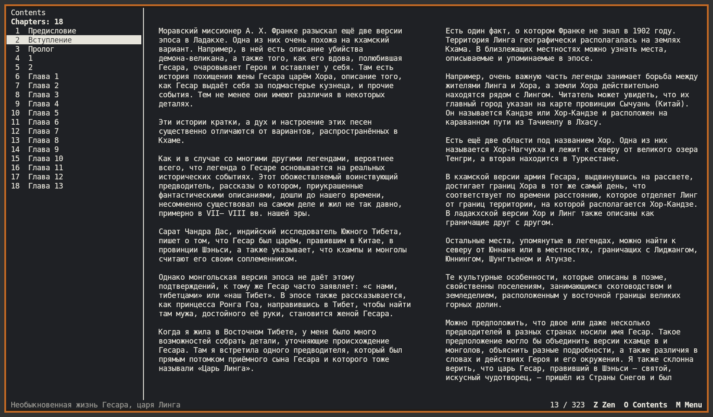
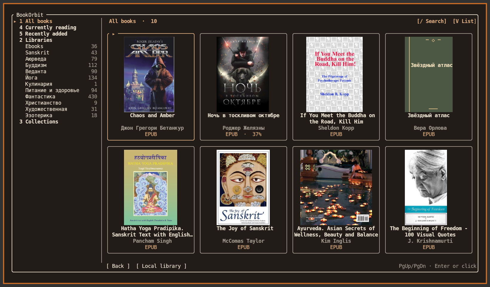

# botui

Терминальная читалка для **BookOrbit, OPDS и локальной папки**. Интерфейс на английском; названия книг, текст и оглавление остаются на языке издания.



## Запуск

```sh
cargo build --release --locked -p botui
./target/release/botui                         # выбрать источник мышью или клавиатурой
./target/release/botui --library "$HOME/Books"  # запомнить корень локальной полки
./target/release/botui --local                 # вернуться в сохранённую папку
./target/release/botui examples/first-light.fb2
./target/release/botui --server https://books.example.org
./target/release/botui --opds https://books.example.org/opds
```

Без заданного пути **Local library** сначала ищет сохранённую папку, затем `~/Books` и, наконец, текущую папку. **P Folder…** позволяет вставить путь; **R Set library here** запоминает папку, в которую вошли вручную. Приложение не меняет исходные книги. В `--opds` укажите адрес самой ленты, в `--server` — корень установки BookOrbit. Если mise не выбрал Cargo, для сборки можно использовать установленный через rustup `~/.cargo/bin/cargo`.

## Полка



На полке BookOrbit **/** ищет по всему каталогу по названию или автору. **1 / 2 / 3** открывают все книги, библиотеки и коллекции; **4 Currently reading** — начатые книги с процентом; **5 Recently added** — последние поступления. Пустые личные коллекции не мешают открыть библиотеку. В режиме списка формат, название, автор и процент занимают выровненные колонки. **V** переключает список и сетку. Колесо, стрелки и PgUp / PgDn перемещают выбор; следующая порция данных подгружается автоматически. Enter или щелчок открывает карточку.

В локальной папке **/** ищет по именам файлов и вложенных каталогов. **4** показывает историю выбранной библиотеки с процентами, **5** — книги по дате создания файла (если она недоступна, по дате изменения). В сетке используются обложки из EPUB/FB2 и первая страница PDF/DjVu. Если обложки нет, клиент рисует собственный цветной переплёт по принципу BookOrbit. В прямом Kitty отображаются растровые изображения; в обычном tmux или Alacritty — цветные полублоки.

**BookOrbit:** пароль и токены остаются в памяти; обычный выход закрывает серверную сессию. **OPDS:** поддерживаются каталоги 1.x/Atom, независимый HTTP Basic через HTTPS, подразделы, автоматическая подгрузка, обложки, выбор файла и поиск, если каталог объявил его через Atom-шаблон или OpenSearch. Для обоих источников **D Save offline** сохраняет выбранное издание. Оно доступно с главного экрана через **Offline downloads** даже без входа.

## Чтение

| Действие | Клавиши |
|---|---|
| Одна страница / разворот, перелистнуть | 1 / 2; ← / →, PgUp / PgDn, колесо |
| Открыть меню или вернуться к книге | M, Esc или щелчок по странице |
| Скрыть интерфейс / вернуть левое оглавление | Z; в обычном режиме Tab переводит фокус между книгой и оглавлением |
| Оглавление в отдельном окне; поиск по тексту | O; / |
| Цвета; сплошной фон; поля текста | T; F; [ / ] |
| Поставить или снять закладку; открыть закладки | B; G |
| Заметка к текущему месту; список заметок; экспорт Markdown | N; A; E |
| Ссылки, сноски и иллюстрации в EPUB/FB2 | I |
| Вернуться после перехода по тексту / повторить переход | , / . |
| Статистика этой книги на устройстве: число сеансов и время с открытой книгой | S |
| Закрыть книгу | Q |

Для EPUB/FB2 обе колонки разворота переразбиваются при изменении полей. В узком окне остаётся одна колонка. EPUB использует издательское оглавление EPUB 2 (NCX) или EPUB 3 (nav), при его отсутствии — заголовки. В оцифрованных книгах читалка может объединять последовательности печатных строк и разорванные слова. Поиск находит восстановленные слова, а исходные адреса для закладок сохраняются. В **I Links & illustrations** можно показать вложенную иллюстрацию, прочитать сноску, перейти по ссылке на главу или явно открыть сайт. Картинки открываются отдельно от текста и не занимают место в развороте. Для книг, где каждый исходный перенос важен, настройте `preserve_printed_lines`.

**PDF и DjVu** открываются как настоящие страницы. В карточке формата нажмите **P Read**. Поддержаны разворот, увеличение (+ / −), сдвиг увеличенной страницы стрелками, переход по оглавлению или номеру страницы, поиск **/** по встроенному текстовому слою (**N** — следующее совпадение). Для перехода к номеру страницы нажмите **O**. **B / G** ставят и открывают локальные закладки, **I / A / E** добавляют заметку к странице, показывают список и экспортируют его в Markdown. **S** показывает статистику этой книги. OCR нет. Поля текста не меняют исходную вёрстку скана. В символьном терминале мелкий текст лучше открыть в графическом Kitty или через **X External viewer** в карточке локального файла. Для PDF нужны Poppler (`pdfinfo`, `pdftoppm`, для поиска `pdftotext`) либо Python 3 с Poppler GI и Cairo; для DjVu — DjVuLibre (`djvused`, `ddjvu`, для поиска `djvutxt`).

## Настройки и данные

Файл настроек создаётся при первом запуске: `$XDG_CONFIG_HOME/botui/config.json` (обычно `~/.config/botui/config.json`). Например:

```json
{
  "library_root": "/home/stefan/Books",
  "zen": false,
  "local_grid": true,
  "theme": "terminal",
  "opaque_background": true,
  "preserve_printed_lines": false
}
```

Палитра терминала или схемы BookOrbit выбираются в **T Theme**. Параметр фона задаёт цвет ячеек; прозрачность, наложенная композитором на окно целиком, остаётся под управлением композитора. Адрес, имя пользователя и вид серверной полки находятся в `connection.json` рядом с основным конфигом. Символьные команды текстовой читалки переопределяются в `reader-keys.json`, например `{"n":"next","p":"previous","о":"contents"}`.

Позиция, закладки и заметки на устройстве привязаны к содержимому файла. Для BookOrbit отдельно читаются позиция и личные текстовые закладки выбранного файла. Место чтения записывается по точному адресу, если со времени открытия оно не изменилось на сервере. Закладки без подходящего адреса остаются в списке с названием. При чтении скачанной книги новый прогресс ждёт следующего входа под тем же аккаунтом; конфликт не перезаписывает чужую позицию. Изменения OPDS и личные заметки остаются локальными. Постоянные загрузки и экспорт заметок находятся в `$XDG_DATA_HOME/botui/{downloads,exports}`; история чтения — в `$XDG_STATE_HOME/botui`.

## Проверки

```sh
cargo fmt --check
cargo clippy --workspace --all-targets --locked -- -D warnings
cargo test --workspace --locked -- --include-ignored
cargo build --workspace --locked
for part in reader library shelf sources progress offline resources; do python3 "scripts/smoke-$part.py" || exit 1; done
```

Сценарии используют частные tmux-сокеты, временные настройки и локальные HTTP-стенды. Для генерации тестового DjVu нужны также `c44` и `djvm`. Подробнее: [устройство](docs/architecture.md) и [проверенные сценарии и открытые пункты](docs/checklist.md).
