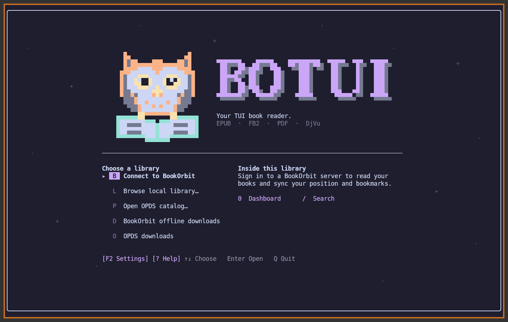
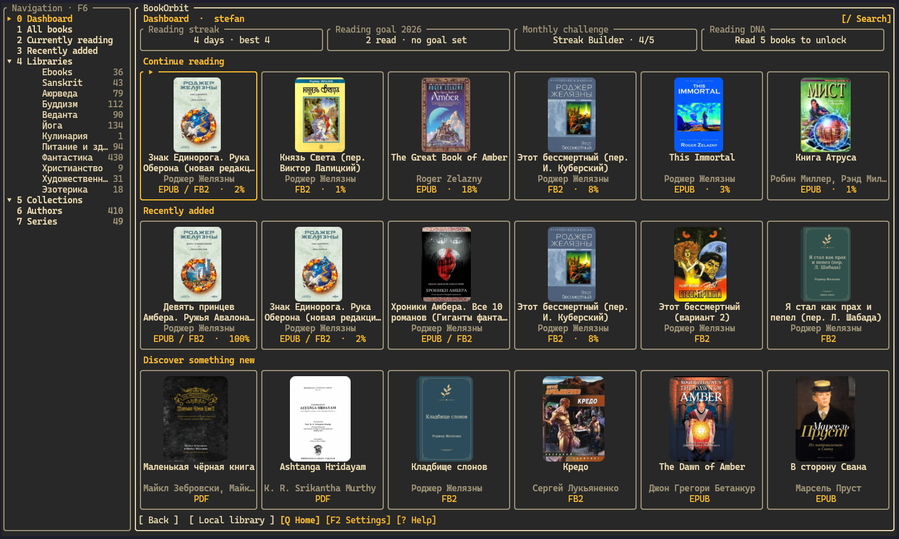
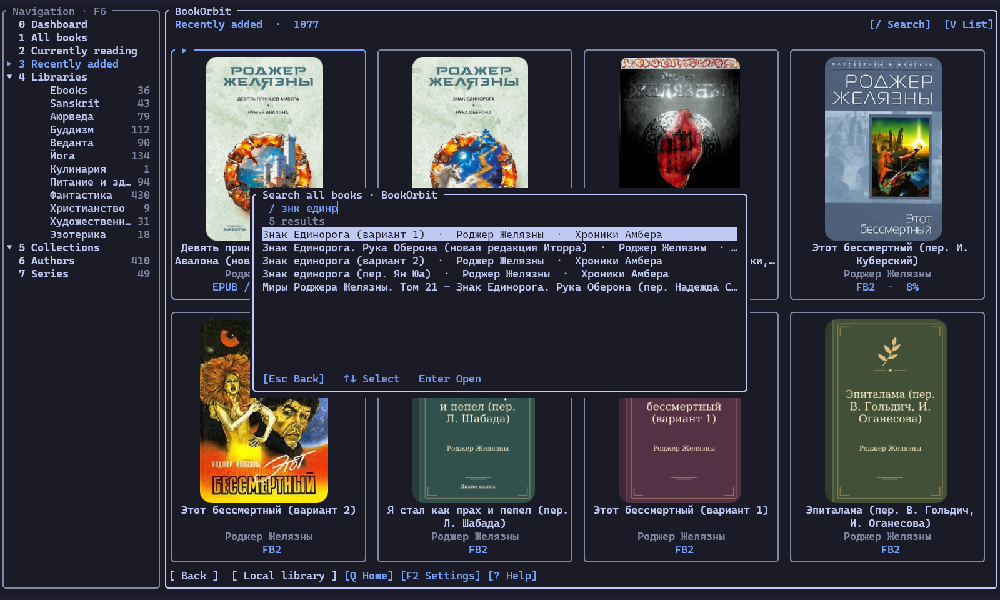
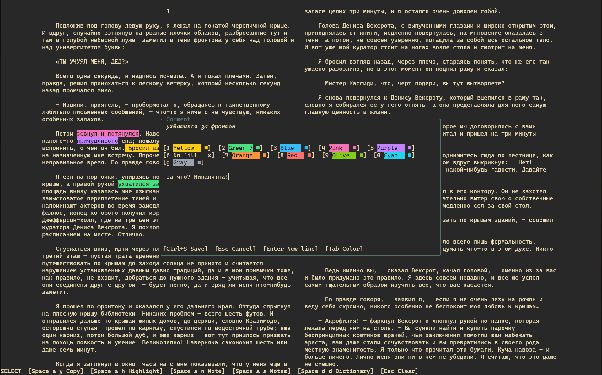
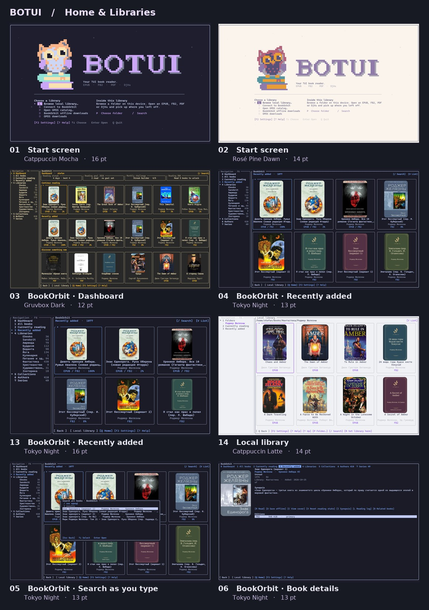

<p align="center"></p>

# botui

**English** · [Русский](README.ru.md)

BOTUI is a terminal book reader for Linux. Open an EPUB, FB2, PDF or DjVu from disk, an OPDS catalog or your BookOrbit library. Read one page at a time, open a two-page spread or scroll continuously.

[Highlights](#highlights) · [Screenshots](#screenshots) · [Installation](#installation) · [First run](#first-run) · [User guide](docs/guide.md) · [Release notes](CHANGELOG.md)

## Highlights

- EPUB, FB2, PDF and DjVu from local folders, OPDS catalogs and BookOrbit
- Cover grid, collections and library search as you type
- Offline reading with BookOrbit progress sync across devices
- Single pages, two-page spreads and continuous scrolling, with an optional contents sidebar
- In-book search, bookmarks, jump history and reading stats
- Text selection, clipboard copy, colored highlights and comments in EPUB/FB2 and text-layer PDF; Markdown export
- Optional Vim cursor and Space command menu; right-click words or selections to copy, highlight, search, translate, define or add a note
- Editable dictionary and translation connections; Free Dictionary and Google Translate enabled as ordinary HTTP profiles
- EPUB tables with merged cells, MathML and TeX formulas, SVG diagrams and inline illustrations
- PDF and DjVu zoom, fit to width and page colors that match the reader theme
- Keyboard and mouse controls, themes, adjustable margins and zen mode

## Libraries

- **Local folders.** Browse by cover or title, find books as you type and organize them into collections. BOTUI remembers your place and caches the jackets it generates for books without covers.
- **BookOrbit.** Browse authors, series and collections. Opening an edition saves a copy on your device. Continue offline and sync your reading position when you reconnect. [BookOrbit project](https://github.com/bookorbit/bookorbit)
- **OPDS.** Browse OPDS 1 and 2 catalogs. Downloaded editions stay on the OPDS downloads shelf and keep their reading positions on this device.

## Screenshots

Click any image to open it at full size.

<table>
  <tr>
    <td width="50%" valign="top">
      <a href="docs/images/start.png"></a><br>
      <strong>Start screen</strong><br><sub>Catppuccin Mocha · 16 pt</sub>
    </td>
    <td width="50%" valign="top">
      <a href="docs/images/dashboard.png"></a><br>
      <strong>BookOrbit dashboard</strong><br><sub>Gruvbox Dark · 12 pt</sub>
    </td>
  </tr>
  <tr>
    <td width="50%" valign="top">
      <a href="docs/images/bookorbit-search.png"></a><br>
      <strong>BookOrbit search as you type</strong><br><sub>Tokyo Night · 13 pt</sub>
    </td>
    <td width="50%" valign="top">
      <a href="docs/images/reading-spread.png"></a><br>
      <strong>Two-page EPUB spread</strong><br><sub>Sepia Dark · 12 pt</sub>
    </td>
  </tr>
</table>

### More themes and font sizes

<table>
  <tr>
    <td width="50%" valign="top">
      <a href="docs/images/shelves-overview-en.jpg"></a><br>
      <strong>Home and libraries</strong>
    </td>
    <td width="50%" valign="top">
      <a href="docs/images/reading-overview-en.jpg"></a><br>
      <strong>Reading modes</strong>
    </td>
  </tr>
</table>

## Installation

### Prebuilt Linux binaries

Download the executable for your architecture (`botui-x86_64` or `botui-aarch64`). Each release includes `SHA256SUMS`. [Linux releases](https://github.com/gAlleb/botui/releases)

Branch builds contain the same files in `botui-linux.tar.gz`. [GitHub Actions](https://github.com/gAlleb/botui/actions/workflows/build.yml)

### With mise

To build from source, run the commands from the repository root. Install a C compiler, a linker and Python 3. The EPUB layout engine uses `python3` during compilation. mise supplies Rust and CMake.

```sh
mise trust
mise install rust cmake
mise run install
```

The install task puts the native build in `./dist/botui`. To build static binaries for **both x86_64 and aarch64**, run `mise install` and `mise run dist`. The two binaries and `SHA256SUMS` appear in `./dist/`.

Cargo caches the native build and each static target separately under `target/` by default. The first build of each target compiles its dependencies. Repeating the same task reuses that work.

### With Cargo

Install rustup, a C compiler, a linker, CMake and Python 3. From the repository root, Cargo uses the Rust version in `rust-toolchain.toml`.

```sh
cargo build --release --locked -p botui --target-dir target &&
  install -Dm755 target/release/botui ./dist/botui
```

### Format support

| Format | Tools needed for reading |
| --- | --- |
| EPUB, FB2 | Built in |
| PDF | Poppler utilities (`pdfinfo`, `pdftoppm`, `pdftotext`) or Python 3 with Poppler GI and Cairo |
| DjVu | DjVuLibre (`djvused`, `ddjvu`, `djvutxt`) |

The PDF contents tree uses Python 3 with PyGObject and the Poppler GI bindings. Searching a PDF or DjVu requires a text layer. PDF text selection and highlights also require Poppler's `pdftotext`; no OCR is performed.

Kitty displays pages and covers as images, including inside tmux with graphics passthrough. Terminals without an image protocol can use colored half-blocks.

## First run

```sh
botui                          # Choose a library
botui --library "$HOME/Books"  # Remember a local folder
botui ./examples/first-light.fb2
botui --resume                 # Continue your last unfinished local book
```

On the start screen, press **Enter** for your local library, **B** for BookOrbit or **P** for OPDS. On a shelf, press **/** to search as you type. Use the arrows and **Enter**, or click a book.

## Controls

<details>
<summary>All reading, Vim and panel commands</summary>

Books open without a cursor. **Space** opens commands; hints appear after **150 ms**, but the next key works immediately. Press keys in sequence, not together. `Space c` enables Vim. Only then do `v`/`V` select text. Legacy letters such as `t`, `b` and `v` have no action in ordinary reading. Explicit user `[keys]` overrides are an exception for EPUB/FB2; they do not override Vim or Space.

In a Space submenu, `q`, `Esc` and `Backspace` return to the root; `Esc` closes the root menu. Shelves and editors have their own contextual keys, listed separately.

| Keys | Action |
| --- | --- |
| `Space c` | Toggle Vim cursor (Normal ↔ reading) |
| `Space m` | Reading menu |
| `Space o` | Contents |
| `Space z` | Zen mode |
| `Space p` | Dim progress footer in zen |
| `Space f` | Find in book |
| `Space b a` | Add/remove bookmark |
| `Space b l` | Bookmark list |
| `Space a y` | Copy selection; Normal: word under cursor |
| `Space a h` | Color highlight |
| `Space a n` | Comment on passage |
| `Space a a` | Highlights and notes |
| `Space a e` | Export annotations to Markdown |
| `Space a v` | Show/hide note body (EPUB/FB2) |
| `Space a p` | Page note (PDF/DjVu) |
| `Space d d` | Word definition |
| `Space d t` | Translate selected text |
| `Space l 1` | Single page |
| `Space l 2` | Two-page spread |
| `Space l 3` | Continuous scroll |
| `Space l w` | Page width / column gap; PDF zoom |
| `Space l f` | Opaque/transparent background |
| `Space l u` | Border style |
| `Space t` | Reading theme; PDF: original / inverted / reading theme |
| `Space s` | Settings |
| `Space ?` | Help |
| `q` / `Q` / `Space q` | Close book and return to its source |
| `Space r c` | Open cover in external viewer |
| `Space r s` | Reading statistics |
| `Space r [` | Jump back |
| `Space r ]` | Jump forward |
| `Space r i` | Links and illustrations (EPUB/FB2) |
| `Space r f` | Follow visible links (EPUB/FB2) |
| `Space r p` | Go to page (PDF/DjVu) |
| `Space r +` | Zoom in (PDF/DjVu) |
| `Space r -` | Zoom out (PDF/DjVu) |
| `Space r 0` | Fit page / fit width in scroll (PDF/DjVu) |
| `Space r r` | Rotate clockwise (PDF/DjVu) |
| `Space r R` | Rotate counterclockwise (PDF/DjVu) |

**Direct navigation in ordinary reading**

| Keys | Action |
| --- | --- |
| `← → / PgUp PgDn` | Navigate pages; in PDF arrows also pan |
| `↑ ↓ / j k` | Move through text; one line in continuous text scroll |
| `h l` | Previous/next page or horizontal movement |
| `1 / 2 / 3` | Single page / spread / scroll; in Vim: command count |
| `+ / = / -` | PDF/DjVu: zoom in / zoom in / zoom out |
| `Home End` | Start/end (PDF: document; Vim: line) |
| `Tab` | Focus visible contents; arrows fold/expand, Enter opens |
| `F1 / F2` | Help / settings |
| `F3 / F4 / F5` | Next match / previous match / result list |
| `Esc` | Back/close panel; reading menu |
| `Ctrl+C` | Copy selected text |

**Vim — after Space c**

| Keys | Action |
| --- | --- |
| `Space c` | Enter Normal; repeat to return to reading from Normal or Visual |
| `v / V` | Visual / logical line selection |
| `Esc` | Cancel pending command or Visual; idle Normal → reading |
| `h j k l` | Cursor left/down/up/right; j/k follow visible lines |
| `w b e` | Next word / previous word / word end |
| `0 ^ $` | Logical line start / first text / end |
| `{ }` | Previous/next paragraph (PDF: text block) |
| `gj gk / g0 g$` | Screen rows / screen row edges (EPUB/FB2) |
| `gg / G` | Start/end of text (PDF: current page) |
| `y` | Copy selection in Visual; begin copy operator in Normal |
| `yw ye yy y$` | Copy to next word / word end / logical line / line end |
| `yiw yaw yip yap` | Copy inner word / word with space / paragraph |
| `3j / 3yw / y3w` | Repeat a motion or copy operation; counts can precede the operator or motion |
| `viw / vaw / vip / vap / gv` | Select inner word / word with space / paragraph / restore previous selection |
| `/ ? / n N` | Search forward/backward / next/previous match |
| ``ma / 'a / `a`` | Set named mark a / return to it |
| `Ctrl+O / Ctrl+I` | Jump back / forward |
| `K` | Definition of word/selection |

**Inside panels and editors**

| Keys | Action |
| --- | --- |
| `↑ ↓ / Enter / click` | Choose and activate an item |
| `Esc` | Close panel; editor offers to save/discard unsaved changes |
| `Ctrl+S / Enter` | Note editor: save / new line; empty saved comment deletes annotation |
| `Tab` | Note editor: change highlight color |
| `[ ] / { }` | Page layout panel: narrow/widen page / decrease/increase column gap |
| `/ / N / H / Y / Del / E` | Annotation list: filter / edit / color / copy / delete / export |
| `P / L / S / Y / N` | Lookup result: provider / target language / source language / copy / save as note |

</details>

<details>
<summary>Libraries, book cards and command-line options</summary>

| Screen | Keys |
| --- | --- |
| Home | Enter/L: local library; B: BookOrbit; P: OPDS; D: BookOrbit offline; O: OPDS downloads; Q: quit |
| Shelves | /: search; V: grid/list; U: borders; F: background; Enter/click: open; Q/Esc: back; F6: focus navigation |
| BookOrbit | 0: dashboard; 1: books; 2: reading; 3: recent; 4: libraries; 5: collections; 6: authors; 7: series |
| Local library | 1: folders; 2: reading; 3: recent; 4: collections; P: choose folder; R: use as root; A: collection membership; I: file details |
| Collections | BookOrbit: N creates; local: New collection in section 4; Del deletes the selected collection after confirmation |
| BookOrbit card | R: read; D: save; C/cover: external cover viewer; I: synopsis; H: hold/resume; X: reset reading; A: collections; L: reading log; B: related books |
| Offline downloads | Del: delete downloaded copy after confirmation |

```sh
botui [FILE | DIRECTORY]
botui --local [DIRECTORY]
botui --library DIRECTORY
botui --resume
botui --server URL
botui --opds URL
botui --config-path
botui --check-bookmarks TITLE
botui --help
botui --license
```

</details>

## Settings and help

Press **F2** for settings or **F1** for shortcuts on the current screen. The interface starts in **Catppuccin Mocha**. Choose **Terminal** to follow your terminal palette.

In **F2 → Reader → Paragraph spacing**, follow the book’s layout or choose 0, 1 or 2 blank lines between paragraphs in EPUB and FB2.

Run `botui --config-path` to locate the TOML file. The [configuration example](config.example.toml) covers library paths, appearance, reading, definition and translation providers, OPDS and BookOrbit sign-in with a password or password command.

On startup, older configs gain missing dictionary/translation defaults, the Space hint delay, mouse-wheel step and an empty OPDS list. Existing values, connections and comments are preserved.

**F2 → Dictionaries → Word definitions / Translation** lets you add, edit, test and delete connections. **Save changes & back** writes them to the same TOML. **F2 → Library → OPDS catalogs** manages saved catalogs.

Free Dictionary and Google Translate are enabled by ordinary HTTP profiles in the default TOML; both can be edited or deleted. Choose an HTTP API, an OpenAI-compatible API or a local command, then enter your own name, optional description and connection settings. HTTP requests and response paths are configurable; additional recipes are commented out below.

### How dictionary connections work

`[lookup]` contains shared settings and default connection names. Each `[[lookup.profiles]]` block defines one connection. `dictionary` and `translation` refer to its exact `name`; an empty name uses the first connection of that purpose. If your config has `profiles = []`, remove that line before adding profile blocks.

All current profiles use the same configuration format. Older versions had short service-specific profiles with hidden endpoints and response parsers. On startup, old service-specific profiles are converted once to explicit HTTP fields; the runtime has no service-specific adapters. F2 creates **HTTP API**, **OpenAI-compatible API**, or **Local command** connections. A generic HTTP profile describes the service's request and response schema explicitly. Empty optional fields written by the UI may be omitted in hand-written TOML.

| HTTP field | Meaning |
| --- | --- |
| `name`, `provider`, `endpoint` | Unique name, `"http"`, and full service URL |
| `purpose` | `"dictionary"` (default) or `"translation"` |
| `method`, `response_format` | Default to `"GET"` and `"json"`; only required for other values |
| `response_path` | Path to JSON strings, e.g. `/translatedText` or `/*/shortdef/*`; `*` iterates arrays. Empty works only for a string at the JSON root |
| `response_separator` | `"\n"` puts definitions on separate lines; the default concatenates strings without a separator |
| `query`, `headers`, `body` | Only the parameters, headers and JSON body required by the service |
| `api_key` / `key_command` | Choose one; the command takes precedence. HTTP sends the key only where `{key}` appears in the template |
| `description` | Optional label for your own reference |

`{text}` is the selected text, `{source}` / `{target}` are language codes, and `{key}` is the key. URL and query values are encoded automatically; JSON body placeholders belong inside strings. Language selection affects a request only when its adapter or template uses that parameter; selecting Russian does not translate an English-only dictionary.

The full example below and `config.example.toml` contain **identical** profiles for Free Dictionary (HTTP), Merriam-Webster Collegiate, a custom translator, an OpenAI-compatible server and local `sdcv`. Free Dictionary and Google Translate are active defaults. The additional recipes are inactive templates. Merriam-Webster needs a key for the Collegiate product; this example displays short definitions (`shortdef`), without audio or full entry formatting. [Merriam-Webster schema](https://dictionaryapi.com/products/json#sec-2.shortdef). Save the profile, select it as default and use **Test connection with ‘hello’** in F2. Testing sends a real request; leaving without saving discards profile edits.

<details>
<summary>Complete config.toml example</summary>

```toml
# Local library. Uncomment to use a specific folder.
# library_root = "/path/to/books"
local_grid = false
# Width of the navigation sidebar on the bookshelf, in cells. Omit for Auto.
# sidebar_width = 28
# Width of the contents sidebar in an open book, in cells. Omit for Auto.
# contents_width = 24
# Per downloaded edition, in MiB (BookOrbit and OPDS). 0 removes the limit.
max_download_mib = 4096

# Reader defaults. Use "terminal" to follow your terminal's colors.
theme = "terminal"
interface_theme = "catppuccin-mocha"
# Optional override. By default, solid Terminal paper follows the active terminal background.
# opaque_color = "#1f2125"
zen = false
# Show a dim page count and percentage in zen mode. Toggle with Space p.
zen_progress = false
# PDF/DjVu zoom in percent. In scroll mode 100 fits the reading pane.
scan_zoom = 100
# Preferred width of one text page and the space between facing pages, in terminal cells.
# page_width = 78
column_gap = 4
# First line of a prose paragraph in EPUB/FB2, in cells (0–8; 0 disables).
paragraph_indent = 0
# Blank lines between EPUB/FB2 paragraphs (0, 1 or 2). Omit to follow the book.
# paragraph_spacing = 1
# Default layout for books without a saved mode: auto, single, spread, scroll.
reading_layout = "auto"
opaque_background = false
# Window frames, cover cards and jackets: "rounded", "square", or "none".
borders = "rounded"
preserve_printed_lines = false
hide_inline_images = false
# Lines per mouse-wheel tick in continuous scroll (EPUB/FB2/PDF/DjVu, 1–12).
scroll_lines = 1
# Delay before the Space command menu appears. Fast sequences execute immediately.
leader_delay_ms = 150
# Legacy lookup_command is still read; use lookup.profiles for new configurations.

[bookorbit]
# Remember which navigation groups are folded on a wide screen.
# libraries_collapsed = false
# collections_collapsed = false
server = ""
username = ""
list_view = false
# Uncomment one way to sign in with this account.
# password_command = ["pass", "show", "bookorbit"]
# password = "your password"

# Reader commands use Space; Space c toggles the optional Vim cursor.
# Direct reader navigation and Vim mappings are documented in README and F1.
# Optional explicit single-letter overrides for EPUB/FB2 reading only.
# They never override Space commands or Vim motions. No overrides by default.
[keys]
# x = "next"
# Supported action names:
# next, previous, menu, zen, zen-progress, background, borders, cover, resources,
# statistics, note, notes, export-notes, jump-back, jump-forward, theme, contents,
# search, search-results, next-match, previous-match, bookmark, bookmarks,
# single, spread, scroll, page-layout, wider-gap, narrower-gap,
# wider-margins (alias narrower-page), narrower-margins (alias wider-page), close

# Multiple OPDS catalogs. Credentials are optional for public catalogs.
# [[opds]]
# name = "My catalog"
# url = "https://books.example.org/opds"
# username = "reader"
# password_command = ["pass", "show", "books/opds"]
# password = "plain-text alternative"

# F2 → Dictionaries has two independent lists: Word definitions and Translation.
# Add/edit/delete a profile in its list, then Save changes & back.
# These names select the default connection in each list; names must be unique.
[lookup]
dictionary = "English dictionary"
translation = "Google Translate"
source_language = "auto"
target_language = "ru"

# Active defaults are ordinary editable HTTP profiles, not built-in providers.
# Remove a block to remove a connection. Set profiles = [] under [lookup]
# only if there are no [[lookup.profiles]] blocks and you want an empty list.
[[lookup.profiles]]
name = "English dictionary"
purpose = "dictionary"
provider = "http"
endpoint = "https://api.dictionaryapi.dev/api/v2/entries/en/{text}"
response_path = "/*/meanings/*/definitions/*/definition"
response_separator = "\n"

[[lookup.profiles]]
name = "Google Translate"
purpose = "translation"
provider = "http"
endpoint = "https://translate.googleapis.com/translate_a/single"
query = { client = "gtx", sl = "{source}", tl = "{target}", dt = "t", q = "{text}" }
response_path = "/0/*/0"
# Translation segments must join without extra separators.
response_separator = ""

# Additional recipes below are inactive. Add your own in F2 > Dictionaries or below.
# The active Google endpoint is unofficial; availability is not guaranteed.
# Minimal HTTP profile: name, provider, endpoint, response_path for nested JSON.
# purpose defaults to "dictionary"; method defaults to GET; response_format to json.
# description, query, headers, body, api_key and key_command are optional.
# response_separator defaults to "" (concatenation); use "\n" for definitions.
# command profiles need name, provider = "command" and command instead of HTTP fields.
# OpenAI profiles need name, provider = "openai" and model; endpoint has a local default.
# name is unique; description is optional and editable. purpose selects the group.
# HTTP templates: {text}, {source}, {target}, {key}. URL/query values are encoded;
# JSON string values are escaped safely. Headers are passed as configured.
# response_path uses /object/key/0 and * for array items. Empty = JSON root.
# response_format = "text" reads a plain UTF-8 response instead of JSON.
# Supported methods: GET (default), POST, PUT, PATCH, DELETE.
# Optional JSON source: "{source?}" omits its object field for auto/empty source.
# {source:upper}/{target:upper} uppercase language codes; {source:upper?} combines both.

# Example only: an English definitions API, not an installed connection.
# [[lookup.profiles]]
# name = "My English dictionary"
# description = "English definitions"
# purpose = "dictionary"
# provider = "http"
# endpoint = "https://api.dictionaryapi.dev/api/v2/entries/en/{text}"
# method = "GET"
# response_format = "json"
# response_path = "/*/meanings/*/definitions/*/definition"
# response_separator = "\n"

# Merriam-Webster Collegiate: short definitions, not full entries or audio.
# Get a key for the Collegiate product: https://dictionaryapi.com/register/index
# Official schema: https://dictionaryapi.com/products/json#sec-2.shortdef
# [[lookup.profiles]]
# name = "Merriam-Webster Collegiate"
# purpose = "dictionary"
# provider = "http"
# endpoint = "https://www.dictionaryapi.com/api/v3/references/collegiate/json/{text}"
# query = { key = "{key}" }
# api_key = "YOUR-COLLEGIATE-API-KEY"
# response_path = "/*/shortdef/*"
# response_separator = "\n"
# Alternative to api_key: key_command = ["pass", "show", "dictionaries/collegiate"]
# If the API returns spelling suggestions instead of entries, this path has no text.
# It reports "No text at the configured response path"; try another spelling.

# Example only: a custom JSON translation API. Match your service's schema.
# [[lookup.profiles]]
# name = "My translator"
# purpose = "translation"
# provider = "http"
# endpoint = "http://localhost:5000/translate"
# method = "POST"
# query = { version = "1" }
# headers = { Authorization = "Bearer {key}" }
# body = '{"q":"{text}","source":"{source}","target":"{target}"}'
# response_format = "json"
# response_path = "/translatedText"
# response_separator = ""
# key_command = ["pass", "show", "translation/api"]
# api_key = "plain-text alternative"
# key_command takes precedence over api_key. Keep only the method you use.

# OpenAI-compatible chat completions, including a locally hosted server.
# [[lookup.profiles]]
# name = "My explanations"
# description = "Explain the selected word"
# purpose = "dictionary" # or "translation"
# provider = "openai"
# endpoint = "http://localhost:11434/v1/chat/completions"
# model = "your-installed-model"
# target_language = "ru" # Explanation language; empty uses lookup.target_language.
# api_key = "optional key"

# Offline dictionary program (install it and its dictionaries separately).
# [[lookup.profiles]]
# name = "My local dictionary"
# purpose = "dictionary"
# provider = "command"
# command = ["sdcv", "-n", "{text}"]
# Arguments are passed without a shell. Also available: {source}, {target}.
```

</details>

[Create and delete collections, add books and remove them](docs/guide.md#managing-collections)

See the [user guide](docs/guide.md) for offline sync, bookmarks, notes, footnotes and PDF controls.

## Development

| Command | What it checks |
| --- | --- |
| `mise run check` | Formatting, Clippy and Rust tests |
| `mise run smoke` | Library and reader workflows in isolated terminal sessions |

Smoke tests need tmux, Python 3.11+, the PDF and DjVu helpers above, and `c44` and `djvm` for test fixtures.

[Architecture](docs/architecture.md) · [Verification checklist](docs/checklist.md) · [Coverage limits](docs/checklist.md#coverage-limits)

## License

BOTUI and its generated book jackets use [GPL-3.0-or-later](LICENSE). Covers supplied by books and catalogs retain their original rights.

PDF/DjVu: `Space t` cycles original colors, inversion and **Reading theme**. The third mode uses **F2 → Reader → Reading theme** (`theme`), not the interface palette. Neutral paper and ink follow the reading colors; saturated illustrations retain their colors. `Space l f` controls opacity as in EPUB/FB2. F2 and library screens keep `interface_theme`.

### Right-click text actions

Right-click a word, or right-click inside an existing selection, to open **Copy, Highlight, Search, Translate, Define, Add note**. A click inside the selection preserves the entire passage; a click on another word targets that word. Search opens in-book search with the selected text (PDF starts its text-layer search). Escape dismisses the menu. The same actions work in EPUB, FB2 and PDF with an embedded text layer; scans without text cannot provide word actions. Translation and definitions use the connections selected in F2 → Dictionaries.
