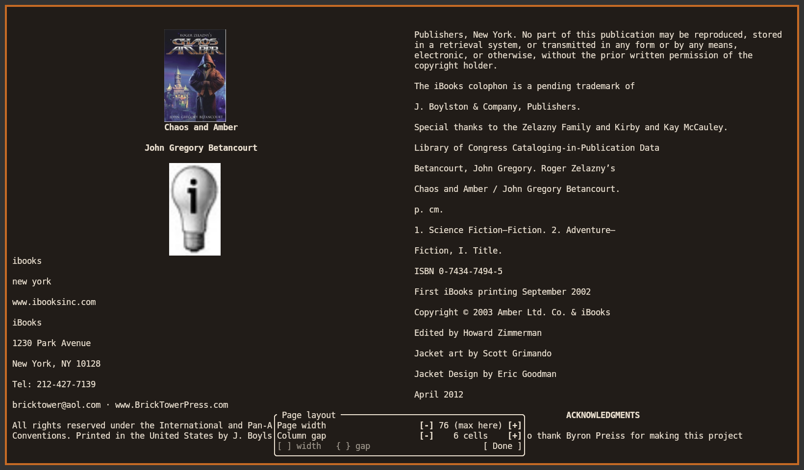
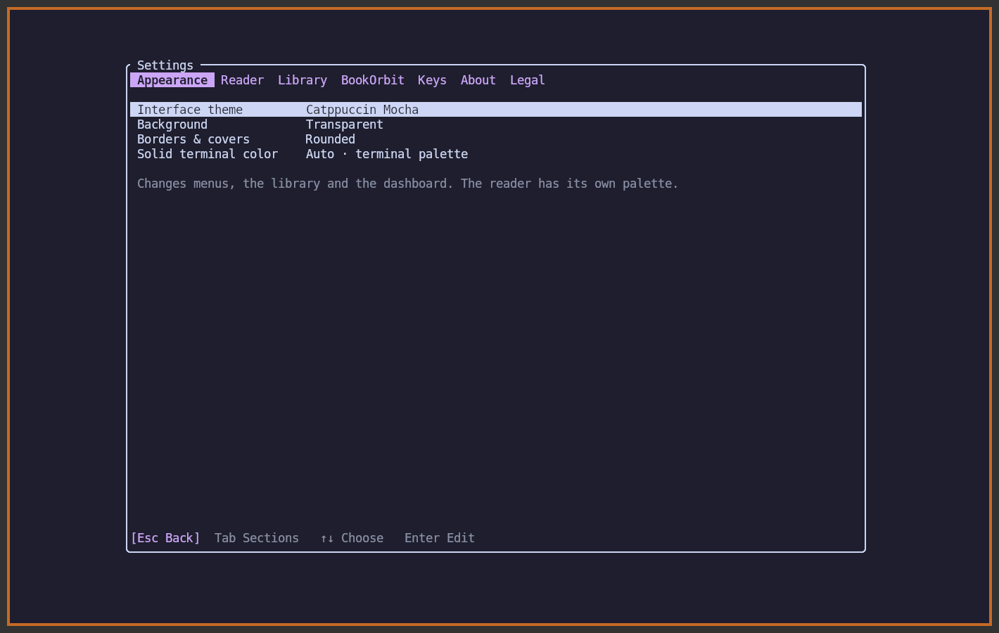

<p align="center"></p>

# botui

**English** · [Русский](README.ru.md)

A standalone terminal book reader for local folders, OPDS catalogs and BookOrbit libraries. Read reflowable EPUB and FB2 or the original PDF and DjVu pages. All four formats support a single page, a facing spread and continuous scrolling, with keyboard and mouse controls.

[Installation](#installation) · [First run](#first-run) · [BookOrbit](#bookorbit) · [Reading](#reading) · [Configuration](#configuration) · [Development](#development)

## Installation

### Linux binaries

Branch builds publish an Actions artifact containing static `botui-x86_64` and `botui-aarch64` executables. Tags such as `v0.1.0` publish both files and `SHA256SUMS` on the release page. Download the file matching `uname -m` and the checksum file into the same directory, then run

```sh
sha256sum --ignore-missing -c SHA256SUMS &&
  install -Dm755 "botui-$(uname -m)" "$HOME/.local/bin/botui"
```

PDF and DjVu use the runtime helpers listed below. To reproduce the release binaries locally, run `mise install` and `mise run dist`. Release notes come from the matching version heading in [CHANGELOG.md](CHANGELOG.md). [GitHub builds](https://github.com/gAlleb/botui/actions/workflows/build.yml) · [Releases](https://github.com/gAlleb/botui/releases)

Build from the repository root on Linux. You need Rust 1.99.1, a C compiler and a linker. The release build produces one executable for the host architecture at `target/release/botui`. The helpers for scanned documents are listed below.

### With mise

The project includes a pinned Rust toolchain and build tasks. From a fresh checkout, run

```sh
mise trust
mise install rust
mise run build
./target/release/botui --help
mise run install
```

The last command installs the executable in `~/.local/bin`. Add that directory to your shell’s `PATH` to run `botui` from anywhere. To use another installation prefix, run `PREFIX=/path/to/prefix mise run install`. After updating the checkout, run the install task again.

### With Cargo

With Rust installed through rustup, the checked-in `rust-toolchain.toml` selects the compiler. To install the release executable directly into the same user bin directory, run

```sh
cargo install --path crates/app --locked --root "$HOME/.local"
```

For a build that stays in the checkout, use `cargo build --release --locked -p botui` and run `./target/release/botui`.

### Document and terminal support

| Format | Reading | Runtime tools |
| --- | --- | --- |
| EPUB, FB2 | Reflow, chapters, text search, links, footnotes and embedded illustrations | Built in |
| PDF | Original pages, spreads, zoom, pan and text-layer search | Poppler utilities (`pdfinfo`, `pdftoppm`, `pdftotext`) or Python 3 with Poppler GI and Cairo |
| DjVu | Original pages, spreads, zoom, pan and text-layer search | DjVuLibre (`djvused`, `ddjvu`, `djvutxt`) |

Direct Kitty supports raster covers and page images. Terminals using the character-cell fallback, including ordinary tmux sessions, display color half-blocks. A graphics-capable terminal gives scanned text more detail. Image-only scans can be read visually. Search requires an existing text layer.

## First run

```sh
botui                                      # choose a source
botui --library "$HOME/Books"              # remember a local library folder
botui --local                              # reopen the saved folder
botui "./examples/first-light.fb2"         # open a file directly
botui --resume                             # continue your last unfinished local book
botui --server https://books.example.org   # BookOrbit installation root
botui --opds https://books.example.org/opds
botui --config-path                        # create or locate the config file
```

On the start screen, move the selection to see the description and controls for that source. The local library is selected at startup. Press **Enter** or **L** to open it, **B** for BookOrbit, **P** for OPDS, **D** for BookOrbit offline downloads or **O** for OPDS downloads. Enter and a click also open the selection.


Click the cover inside a book card, or press **C**, to open it with your system image viewer. On the shelf, clicking still opens the book card. In a local EPUB or FB2, **C** opens the embedded cover. If a book or catalog has no cover image, BOTUI makes a [cloth jacket](docs/images/generated-jacket.png) from the title and author. For PDF and DjVu, **C** shows the first page. BOTUI uses the desktop’s image association via `xdg-open`.

**F2** opens Settings: Appearance, Reader, Library, BookOrbit, Keys, About and Legal. **?** or **F1** opens the shortcut guide for the current screen. Use **[ / ]** to switch groups or type **/** to find a key or command. The footer shortcuts are clickable. **Q** closes the book, **Q** on the shelf returns to the source chooser, and **Q** there exits. **Esc** goes up one catalog level. When launched with a single file path, closing that file ends the command.

**Local library** uses your saved root, then `~/Books`, then the current directory. Click **P Folder…** to paste a path. **R Set library here** remembers the folder currently on screen. **/** searches subfolders in the background. It matches the path, plus the embedded title, author and series of EPUB and FB2 files; the filename may be just a number. **2** opens reading history with percentages and **3** shows recent files by creation time, falling back to modification time.

In a wide terminal the left pane shows the folder tree, currently reading and recently added. Click a folder name to display its books on the right; click its arrow to fold or expand it. **F6** switches focus, **← / →** fold or expand, and **Enter** opens a folder. Drag the divider to resize it. Small windows keep the numbered tabs. [See the local library in Kitty](docs/images/local-library.png).

## BookOrbit


Choose **Connect to BookOrbit** to sign in. The dashboard shows continue reading, recent additions and discovery shelves. Reading streaks, yearly goals, challenges and Reading DNA appear when the server supplies those widgets. Select a book to choose its file. Use **0** to revisit and refresh the dashboard.

| Key | Section | Key | Section |
| --- | --- | --- | --- |
| 0 | Dashboard | 4 | Libraries |
| 1 | All books | 5 | Collections |
| 2 | Currently reading | 6 | Authors |
| 3 | Recently added | 7 | Series |

**Authors** and **Series** show account-wide totals and the number of books in each entry. Open an author to see their books, or a series to read its volumes in server order. **/** searches the current directory in these two sections. On book shelves it searches the whole catalog by title or author, including books beyond the loaded rows.

**V** switches between cover grid and list. **Tab / Shift+Tab** change sections in display order. Arrows, the wheel and Page Up / Page Down navigate a shelf. More items load as you scroll. Enter or a click opens the selection. **Esc** goes back.

**Read** downloads a BookOrbit edition on first use and keeps it on this device. Open it from its card again to read the saved file and load the account’s reading position and text bookmarks. **D Save offline** downloads ahead of time or checks a saved copy for updates. If BookOrbit reports a changed edition, BOTUI checks the server version before replacing the file.

Without a connection, select **BookOrbit offline downloads** on the start screen. If you left an EPUB at chapter 5 online and read to chapter 7 offline, closing it queues chapter 7 for the same account and edition. BOTUI retries while running with an active session or a configured password or password command. Pending progress survives a restart. If you enter your password manually, signing in sends queued progress. A conflicting change on another device is reported and the offline position is kept. Offline bookmarks are local. **OPDS downloads** has its own shelf and uses device-local progress.

Wide screens have a separately framed navigation tree. Click **Libraries** or **Collections** to fold them, or press **F6**, move with **↑/↓** and fold or expand with **←/→**. **4 / 5** open the full directories. Folded groups are remembered.

Before opening an edition, its card shows the author, series, synopsis, publisher, date, language, ISBN and reading progress when supplied by the server. **R** reads the selected edition, **D** saves it offline and **I** opens the full synopsis. **H Put on hold** removes a book from active reading and keeps your place; **H Resume reading** puts it back. **X Reset reading state** requires confirmation, clears personal progress across the book’s editions and changes it to Unread on BookOrbit. It keeps files, bookmarks and notes. Reaching the end sends 100%; BookOrbit applies its own completion policy. Use `botui --check-bookmarks "Title"` to check edition-specific bookmark addresses without changing progress.

See the [book details before reading](docs/images/book-details.png) and [navigation with the libraries folded](docs/images/navigation-folded.png).

**L Reading log** opens sessions recorded by BookOrbit, with dates, devices, time and progress. **B Related books** opens the author or series. The local timer under **S** counts time in BOTUI on this device.

**OPDS** accepts OPDS 1 Atom and OPDS 2 JSON. Browse navigation, groups and facets; choose an edition, search through an advertised template or OpenSearch, and download direct acquisitions. Use HTTPS for HTTP Basic accounts. Loan-only and DRM entries remain catalog information. Positions and notes are local.

## Reading



| EPUB and FB2 action | Controls |
| --- | --- |
| Turn pages | Left / Right, Page Up / Page Down, mouse wheel |
| Single page / facing spread / continuous scroll | **1 / 2 / 3**. In scroll mode ↑/↓ move one line, the wheel moves several, and PgUp/PgDn move a screen |
| Open menu | **M**, Esc or click the page |
| Adjust page width and column gap with a live preview | **W**, then click **− / +** on either row |
| Adjust without opening the panel | **[** wider page, **]** narrower page. **{** smaller gap, **}** larger gap |
| Zen mode / contents sidebar | **Z**. In the normal view, **Tab** changes focus |
| Contents / search / links and illustrations | **O / slash / I** |
| Theme / opaque background / border style | **T / F / U** |
| Toggle bookmark / open bookmarks | **B / G** |
| Write a passage note / list notes / export Markdown | **N / A / E** |
| Jump back / forward | **, / .** |
| Book statistics / close | **S / Q** |

Width and spacing are in terminal cells. Extra room sits outside the spread. A narrow window shows one page. Resize or adjust either value while reading to reflow both pages around the current text position. In scanned EPUB/FB2 text, botui can join printed line breaks and split words. Set `preserve_printed_lines = true` for editions where those breaks are intentional.

In EPUB and FB2, click an underlined reference or press **F6** to follow a link on the visible page. If several are visible, choose one. When you visit a note or glossary entry at the end of the book, **Esc** or **Back** restores your reading position; **Enter · Read here** makes an in-book destination your new reading position. Supplementary notes open over the current page. **I** still lists resources from the whole book.

For **PDF and DjVu**, press **Enter** or click the edition to start reading. **1 / 2 / 3** select single page, spread or continuous scroll. At **100%**, a scrolling sheet fits the reading pane. Press **−** once for **90%**, again for **80%**, or **+** to enlarge it. **0** restores fit. **W** opens the same controls for the mouse; the chosen zoom is saved when you close the book. **Z** hides the contents and footer. **P** or **Ctrl+G** opens a small page-number dialog over the document. **/** searches the text layer; **F3 / F4 / F5** open the next match, previous match, or results. **B / G** manage bookmarks; **I / A / E** manage and export notes. Use **R / Shift+R** to rotate a scan clockwise or counterclockwise and **V** to invert its colors. BOTUI remembers the view for each edition and checkpoints your place while reading. Local resume remembers your position within a sheet; BookOrbit syncs the page number. Image-only scans have no searchable text without OCR. [PDF in Kitty](docs/images/pdf-scroll.png).

Embedded raster illustrations appear in the text; **I** also opens the separate viewer. Tables adapt to the available width. Set **F2 → Reader → Illustrations** to viewer only if desired. **S** displays book statistics; **F2 → Library → Reading statistics** shows totals on this device.

Across all four formats, **F3 / F4** move to the next / previous search result; **F5** reopens the list. EPUB/FB2 highlight the selected phrase. For scans the list shows page numbers and text excerpts; **, / .** retrace jumps. In **G Bookmarks**, press **Delete** on the selection or click **[×]** beside an entry, then confirm.

## Configuration

Run `botui --config-path` to print the exact path. The default is `~/.config/botui/config.toml`. The same TOML file holds the library root, interface, reader bindings and BookOrbit account. The default UI language is English. See the [commented configuration](config.example.toml).

On first launch the interface uses **Catppuccin Mocha**; existing theme choices are preserved. **F2 → Reader → First-line indent** accepts 0–8 cells for the first line of prose (0 turns it off). Drag the right edge of the navigation or contents panel to resize it, or set the width in Settings. **F2 → Library → Download limit** sets the maximum size per edition for BookOrbit and OPDS: **4096 MiB** by default, **0** for unlimited. Downloads stream to disk. [Keyboard help](docs/images/help.png).

**F2 → Appearance** sets the interface palette independently of the reading paper (**T**). Terminal uses the default foreground, background and ANSI slots, so changes to the emulator’s palette appear without restarting. Opaque paper follows the emulator’s OSC 11 response; if it cannot report RGB, botui uses ANSI black or your explicit `opaque_color`. Neither pywal nor matugen is required. Built-in themes include Gruvbox, Catppuccin, Nord, Dracula, Tokyo Night, Solarized, One Dark, Kanagawa, Rosé Pine and Everforest. A named palette stays fixed; transparency lets the window background show through. Set borders and jacket corners to Rounded, Square or None here.



```toml
library_root = "/path/to/books"
interface_theme = "catppuccin-mocha"
theme = "terminal"
reading_layout = "auto"    # auto, single, spread, scroll
borders = "rounded"        # rounded, square, none
opaque_background = false
page_width = 78
column_gap = 4
paragraph_indent = 0
max_download_mib = 4096
scan_zoom = 100

[bookorbit]
server = "https://books.example.org"
username = "reader"
password_command = ["pass", "show", "bookorbit"]
# password = "your password"

[keys]
n = "next"
p = "previous"
```

To use a password manager, set `password_command` to an argument array as above. A string runs through `sh -c`. The command must exit successfully and return the password on the first output line. For a stored plaintext password, use `password`. Omit both to type the password at login. A typed password takes precedence, followed by the command, then the stored password. Saved credentials are bound to the configured server and username. Tokens stay in memory and normal exit closes the server session.

The app creates its config with mode `0600`. On upgrade it imports the earlier JSON preferences, connection and reader bindings, preserving their originals under `$XDG_STATE_HOME/botui/config-backup`. UI changes preserve unrelated TOML values and comments. The interface can use the terminal palette or BookOrbit reader themes. **F** sets the background of terminal cells. Whole-window opacity is controlled by the terminal or compositor.

| Data | Default location |
| --- | --- |
| Config | `~/.config/botui/config.toml` |
| Positions, local bookmarks, notes and reading history | `~/.local/state/botui/` |
| Offline books and Markdown exports | `~/.local/share/botui/downloads/`, `~/.local/share/botui/exports/` |

The XDG config, state and data environment variables override those defaults. Local reading records use a content hash, so moving a file preserves its position.

## Development

```sh
mise run check
mise run smoke
```

`check` runs rustfmt, Clippy and the workspace tests. `smoke` builds the debug binaries and exercises real terminal sessions with private tmux sockets, temporary configuration and loopback HTTP fixtures. It requires Python 3.11+, tmux, PDF and DjVu rendering support, and the DjVu fixture tools `c44` and `djvm`.

The Rust workspace separates the BookOrbit and OPDS adapters, ebook parsing, text layout, fixed-page rendering, local storage and the terminal application. The repository also includes [architecture notes](docs/architecture.md) and the [verification checklist](docs/checklist.md), both in Russian. [Upstream comparison and known gaps](docs/upstream-audit.md).

## License

BOTUI and its generated jackets are licensed under [GPL-3.0-or-later](LICENSE). **F2 → Legal** identifies the license. Run `botui --license` for its full text. Book covers supplied by publishers or catalogs retain their own rights.
