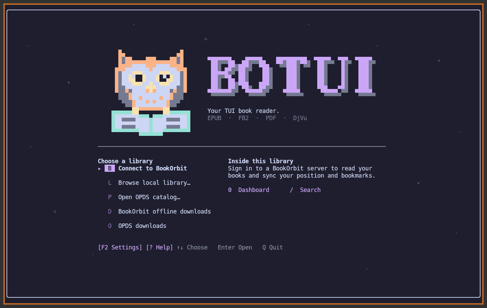
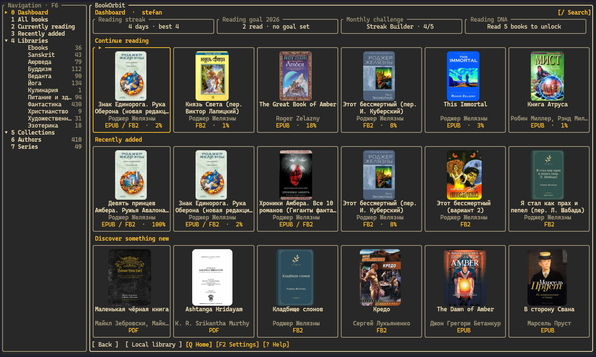
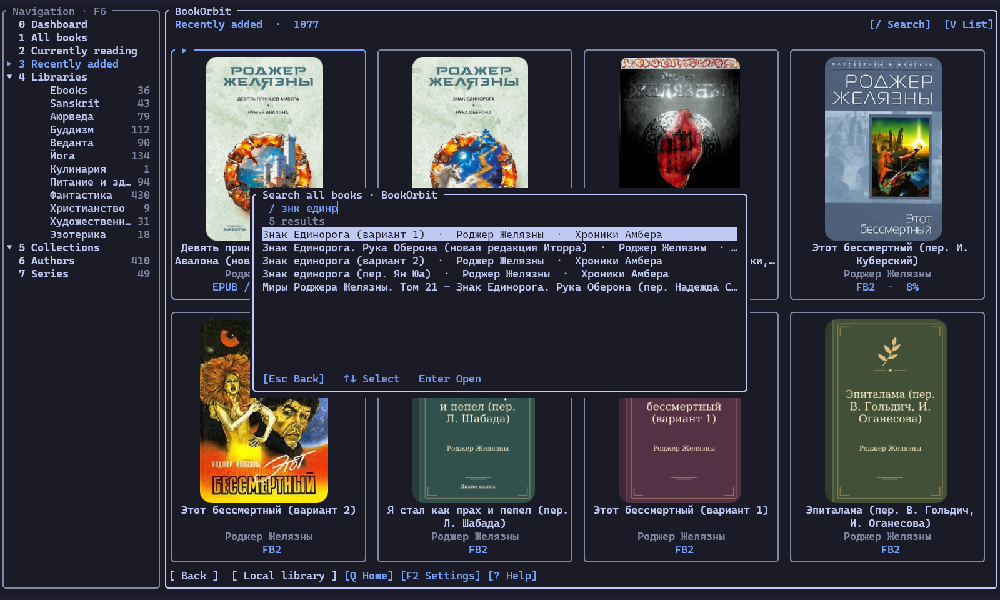
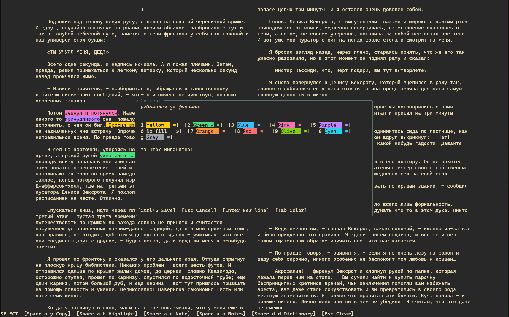
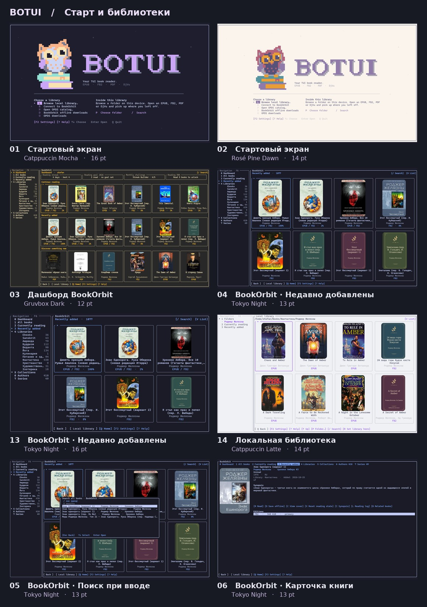
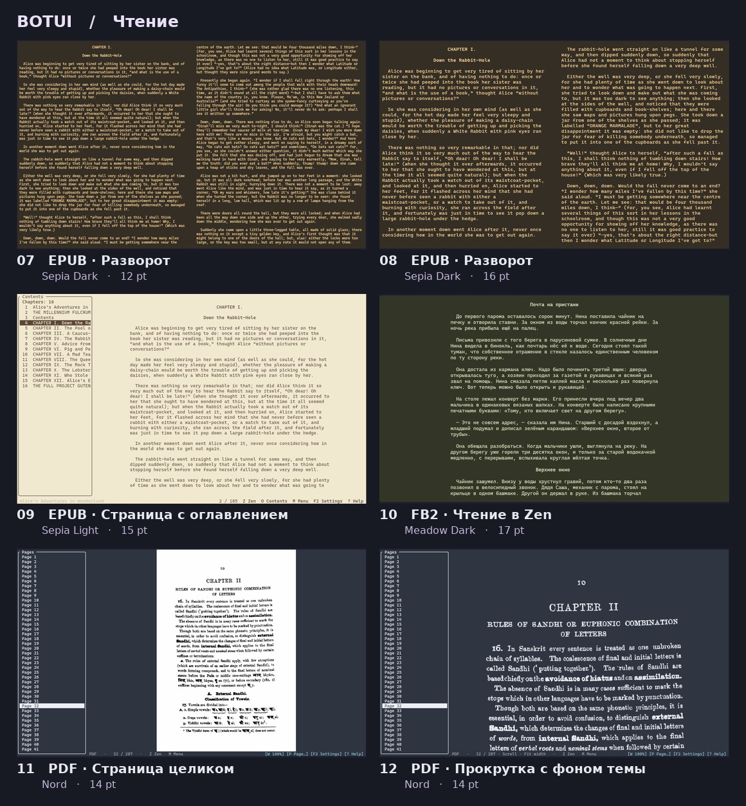

<p align="center"></p>

# botui

[English](README.md) · **Русский**

BOTUI — терминальная читалка для Linux. Откройте EPUB, FB2, PDF или DjVu с диска, из каталога OPDS или своей библиотеки BookOrbit. Читайте по одной странице, разворотами или с непрерывной прокруткой.

[Возможности](#возможности) · [Скриншоты](#скриншоты) · [Установка](#установка) · [Первый запуск](#первый-запуск) · [Руководство](docs/guide.ru.md) · [История изменений (EN)](CHANGELOG.md)

## Возможности

- EPUB, FB2, PDF и DjVu из локальных папок, каталогов OPDS и библиотеки BookOrbit
- Сетка обложек, коллекции и поиск книг по мере ввода
- Офлайн-чтение книг BookOrbit с синхронизацией позиции между устройствами
- Одна страница, разворот или непрерывная прокрутка. Оглавление слева можно скрыть
- Поиск по тексту, закладки, история переходов и статистика чтения
- Выделение, копирование, цветные пометки и комментарии в EPUB/FB2 и PDF с текстовым слоем; экспорт Markdown
- Необязательный Vim-курсор, меню Space, словари и перевод с выбором языка
- Таблицы с объединёнными ячейками, формулы MathML и TeX, SVG-схемы и иллюстрации в EPUB
- Масштабирование PDF и DjVu, подгонка по ширине и фон страницы в цвет темы
- Управление клавиатурой и мышью, темы оформления, настраиваемые поля и дзен-режим

## Библиотеки

- **Локальные папки.** Листайте обложки или список названий, ищите книги по мере ввода и собирайте их в коллекции. BOTUI запоминает место чтения. Если у книги нет обложки, читалка рисует свой переплёт и сохраняет его для следующего запуска.
- **BookOrbit.** Выбирайте книги по авторам, сериям и коллекциям. При первом открытии BOTUI сохраняет издание на устройстве. Можно продолжать читать офлайн и синхронизировать позицию при подключении. [Проект BookOrbit](https://github.com/bookorbit/bookorbit)
- **OPDS.** Просматривайте каталоги OPDS 1 и 2. Скачанные издания хранятся на отдельной полке, а позиция чтения — на этом устройстве.

## Скриншоты

Нажмите на изображение, чтобы открыть его в полном размере.

<table>
  <tr>
    <td width="50%" valign="top">
      <a href="docs/images/start.png"></a><br>
      <strong>Стартовый экран</strong><br><sub>Catppuccin Mocha · 16 pt</sub>
    </td>
    <td width="50%" valign="top">
      <a href="docs/images/dashboard.png"></a><br>
      <strong>Дашборд BookOrbit</strong><br><sub>Gruvbox Dark · 12 pt</sub>
    </td>
  </tr>
  <tr>
    <td width="50%" valign="top">
      <a href="docs/images/bookorbit-search.png"></a><br>
      <strong>Поиск по мере ввода в BookOrbit</strong><br><sub>Tokyo Night · 13 pt</sub>
    </td>
    <td width="50%" valign="top">
      <a href="docs/images/reading-spread.png"></a><br>
      <strong>Разворот EPUB</strong><br><sub>Sepia Dark · 12 pt</sub>
    </td>
  </tr>
</table>

### Другие темы и размеры шрифта

<table>
  <tr>
    <td width="50%" valign="top">
      <a href="docs/images/shelves-overview-ru.jpg"></a><br>
      <strong>Стартовый экран и библиотеки</strong>
    </td>
    <td width="50%" valign="top">
      <a href="docs/images/reading-overview-ru.jpg"></a><br>
      <strong>Режимы чтения</strong>
    </td>
  </tr>
</table>

## Установка

### Готовые бинарники для Linux

Скачайте исполняемый файл для вашей архитектуры (`botui-x86_64` или `botui-aarch64`). В каждом релизе есть файл контрольных сумм `SHA256SUMS`. [Релизы для Linux](https://github.com/gAlleb/botui/releases)

В сборках веток те же файлы упакованы в `botui-linux.tar.gz`. [GitHub Actions](https://github.com/gAlleb/botui/actions/workflows/build.yml)

### Через mise

Для сборки из исходников установите компилятор C, компоновщик и Python 3. Движок вёрстки EPUB использует `python3` во время компиляции. Rust и CMake установит mise. Выполните команды из корня репозитория.

```sh
mise trust
mise install rust cmake
mise run install
```

Задача install собирает версию для вашей машины и кладёт её в `./dist/botui`. Чтобы получить статические бинарники сразу для **x86_64 и aarch64**, выполните `mise install` и `mise run dist`. Оба файла и `SHA256SUMS` появятся в `./dist/`.

Cargo по умолчанию хранит в `target/` отдельный кэш для родной сборки и каждой из двух статических. При первой сборке каждого варианта компилируются его зависимости. Повторный запуск той же задачи использует готовые файлы.

### Через Cargo

Установите rustup, компилятор C, компоновщик, CMake и Python 3. При запуске из корня репозитория Cargo использует версию Rust из `rust-toolchain.toml`.

```sh
cargo build --release --locked -p botui --target-dir target &&
  install -Dm755 target/release/botui ./dist/botui
```

### Поддержка форматов

| Формат | Что нужно для чтения |
| --- | --- |
| EPUB, FB2 | Поддержка встроена |
| PDF | Утилиты Poppler (`pdfinfo`, `pdftoppm`, `pdftotext`) или Python 3 с Poppler GI и Cairo |
| DjVu | DjVuLibre (`djvused`, `ddjvu`, `djvutxt`) |

Для дерева оглавления PDF нужны Python 3, PyGObject и привязки Poppler GI. Для поиска внутри PDF и DjVu нужен текстовый слой. Для выделения текста и цветных пометок PDF также нужен `pdftotext` из Poppler; распознавание сканов не выполняется.

Kitty показывает страницы и обложки как изображения, в том числе в tmux с включённым пробросом графики. В терминалах без графического протокола доступен вывод цветными полублоками.

## Первый запуск

```sh
botui                          # Выбрать библиотеку
botui --library "$HOME/Books"  # Запомнить локальную папку
botui ./examples/first-light.fb2
botui --resume                 # Продолжить последнюю недочитанную локальную книгу
```

На стартовом экране **Enter** открывает локальную библиотеку, **B** — BookOrbit, **P** — OPDS. Для поиска на полке нажмите **/** и начните вводить название. Выберите книгу стрелками и нажмите **Enter** или щёлкните по ней.

## Управление

<details>
<summary>Полный список команд чтения, Vim и окон</summary>

Книга открывается без курсора. **Space** открывает команды; подсказка появляется через **150 мс**, но следующую клавишу можно нажать сразу. Это последовательность, не одновременное нажатие. `Space c` включает Vim. Только тогда `v`/`V` выделяют текст. В обычном чтении старые буквы `t`, `b`, `v` и т. п. не выполняют команды. Явные пользовательские `[keys]` — исключение для EPUB/FB2; они не меняют Vim и Space.

В подменю Space `q`, `Esc` и `Backspace` возвращают на первый уровень; `Esc` закрывает корневое меню. Библиотеки и редакторы имеют собственные клавиши, перечисленные отдельно.

| Клавиши | Действие |
| --- | --- |
| `Space c` | Включить курсор Vim / вернуться в чтение |
| `Space m` | Меню чтения |
| `Space o` | Оглавление |
| `Space z` | Дзен-режим |
| `Space p` | Тусклая строка прогресса в дзене |
| `Space f` | Поиск в книге |
| `Space b a` | Поставить/снять закладку |
| `Space b l` | Список закладок |
| `Space a y` | Копировать выделение; в Normal — слово под курсором |
| `Space a h` | Цветное выделение |
| `Space a n` | Комментарий к фрагменту |
| `Space a a` | Выделения и заметки |
| `Space a e` | Экспорт пометок в Markdown |
| `Space a v` | Показать/скрыть текст заметки (EPUB/FB2) |
| `Space a p` | Заметка к странице (PDF/DjVu) |
| `Space d d` | Значение слова |
| `Space d t` | Перевести выделенный текст |
| `Space l 1` | Одна страница |
| `Space l 2` | Разворот |
| `Space l 3` | Непрерывная прокрутка |
| `Space l w` | Ширина страниц / зазор; масштаб PDF |
| `Space l f` | Непрозрачный/прозрачный фон |
| `Space l u` | Стиль границ |
| `Space t` | Тема чтения; PDF: оригинал / инверсия / фон темы |
| `Space s` | Настройки |
| `Space ?` | Справка |
| `q` / `Q` / `Space q` | Закрыть книгу и вернуться к её источнику |
| `Space r c` | Открыть обложку во внешнем просмотрщике |
| `Space r s` | Статистика чтения |
| `Space r [` | Вернуться к предыдущему месту |
| `Space r ]` | Перейти вперёд по истории |
| `Space r i` | Ссылки и иллюстрации (EPUB/FB2) |
| `Space r f` | Перейти по видимым ссылкам (EPUB/FB2) |
| `Space r p` | Номер страницы (PDF/DjVu) |
| `Space r +` | Увеличить (PDF/DjVu) |
| `Space r -` | Уменьшить (PDF/DjVu) |
| `Space r 0` | Вписать страницу / по ширине в прокрутке (PDF/DjVu) |
| `Space r r` | Повернуть по часовой стрелке (PDF/DjVu) |
| `Space r R` | Повернуть против часовой стрелки (PDF/DjVu) |

**Без префикса в обычном чтении**

| Клавиши | Действие |
| --- | --- |
| `← → / PgUp PgDn` | Листать страницы; в PDF стрелки также сдвигают увеличенный лист |
| `↑ ↓ / j k` | Перемещение по тексту; по строке в режиме прокрутки текста |
| `h l` | Предыдущая/следующая страница или горизонтальное перемещение |
| `1 / 2 / 3` | Одна страница / разворот / прокрутка; в Vim — счётчик |
| `+ / = / -` | PDF/DjVu: увеличить / увеличить / уменьшить масштаб |
| `Home End` | Начало/конец (PDF: документ; Vim: строка) |
| `Tab` | Фокус видимого оглавления; стрелки сворачивают/разворачивают, Enter открывает |
| `F1 / F2` | Справка / настройки |
| `F3 / F4 / F5` | Следующее / предыдущее совпадение / список результатов |
| `Esc` | Назад/закрыть окно; меню чтения |
| `Ctrl+C` | Копировать выделенный текст |

**Vim — после Space c**

| Клавиши | Действие |
| --- | --- |
| `Space c` | Войти в Normal; повторить для выхода в чтение из Normal или Visual |
| `v / V` | Visual / выделение логической строки |
| `Esc` | Отменить незавершённую команду или Visual; из свободного Normal → чтение |
| `h j k l` | Курсор влево/вниз/вверх/вправо; j/k идут по видимым строкам |
| `w b e` | Следующее слово / предыдущее / конец слова |
| `0 ^ $` | Начало логической строки / первый текст / конец |
| `{ }` | Предыдущий/следующий абзац (PDF: блок текста) |
| `gj gk / g0 g$` | Экранные строки / края экранной строки (EPUB/FB2) |
| `gg / G` | Начало/конец текста (PDF: текущая страница) |
| `y` | Копировать выделение в Visual; начать оператор копирования в Normal |
| `yw ye yy y$` | Копировать до следующего слова / конца слова / строку / до конца строки |
| `yiw yaw yip yap` | Копировать слово / слово с пробелом / абзац |
| `3j / 3yw / y3w` | Повторить движение или копирование; число можно поставить перед оператором или движением |
| `viw / vaw / vip / vap / gv` | Выделить слово / слово с пробелом / абзац / восстановить предыдущее выделение |
| `/ ? / n N` | Поиск вперёд/назад / следующее/предыдущее совпадение |
| ``ma / 'a / `a`` | Поставить именованную метку a / вернуться к ней |
| `Ctrl+O / Ctrl+I` | Назад / вперёд по истории |
| `K` | Значение слова/выделения |

**Открытые окна и редакторы**

| Клавиши | Действие |
| --- | --- |
| `↑ ↓ / Enter / click` | Выбрать и открыть пункт |
| `Esc` | Закрыть окно; редактор настроек предложит сохранить/отбросить правки |
| `Ctrl+S / Enter` | Редактор заметки: сохранить / новая строка; пустая сохранённая заметка удаляется |
| `Tab` | Редактор заметки: цвет выделения |
| `[ ] / { }` | Настройка страницы: ширина страницы / расстояние между колонками |
| `/ / N / H / Y / Del / E` | Список пометок: поиск / изменить / цвет / копировать / удалить / экспорт |
| `P / L / S / Y / N` | Ответ словаря: подключение / язык ответа / исходный язык / копировать / сохранить заметкой |

</details>

<details>
<summary>Библиотеки, карточки и запуск из командной строки</summary>

| Экран | Клавиши |
| --- | --- |
| Начальный экран | Enter/L — локальная библиотека; B — BookOrbit; P — OPDS; D — офлайн BookOrbit; O — загрузки OPDS; Q — выход |
| Полки | / — поиск; V — сетка/список; U — границы; F — фон; Enter/щелчок — открыть; Q/Esc — назад; F6 — левая панель |
| BookOrbit | 0 — дашборд; 1 — книги; 2 — читаемые; 3 — недавние; 4 — библиотеки; 5 — коллекции; 6 — авторы; 7 — серии |
| Локальная библиотека | 1 — папки; 2 — читаемые; 3 — недавние; 4 — коллекции; P — выбрать папку; R — сделать её корнем; A — состав коллекций; I — сведения о файле |
| Коллекции | BookOrbit: N создаёт коллекцию; локальные: New collection в разделе 4; Del удаляет выбранную коллекцию с подтверждением |
| Карточка BookOrbit | R — читать; D — сохранить; C/обложка — просмотр обложки; I — аннотация; H — отложить/возобновить; X — сбросить чтение; A — коллекции; L — журнал; B — похожие книги |
| Офлайн-загрузки | Del — удалить скачанную копию с подтверждением |

```sh
botui [FILE | DIRECTORY]
botui --local [DIRECTORY]
botui --library DIRECTORY
botui --resume
botui --server URL
botui --opds URL
botui --config-path
botui --check-bookmarks TITLE
botui --help
botui --license
```

</details>

## Настройки и справка

**F2** открывает настройки, **F1** — подсказки для текущего экрана. При первом запуске включена тема **Catppuccin Mocha**. Выберите **Terminal**, чтобы использовать палитру терминала.

В **F2 → Reader → Paragraph spacing** можно оставить оформление книги или задать свой интервал между абзацами EPUB и FB2 — 0, 1 или 2 пустые строки.

Команда `botui --config-path` покажет путь к TOML-файлу. В [примере конфига](config.example.toml) есть папка библиотеки, темы и чтение, словари значений и перевода, OPDS и вход в BookOrbit по паролю или через менеджер паролей.

При запуске в старый конфиг добавляются отсутствующие настройки словарей и перевода, задержки Space, шага колеса и пустой список OPDS. Существующие значения, подключения и комментарии сохраняются.

В **F2 → Dictionaries → Word definitions / Translation** можно добавлять, изменять, проверять и удалять подключения. **Save changes & back** записывает их в тот же TOML. В **F2 → Library → OPDS catalogs** настраиваются каталоги OPDS.

Оба списка изначально пустые. Выбери HTTP API, OpenAI-совместимый API или локальную команду, затем задай своё название, необязательное описание и параметры подключения. HTTP-запрос и путь к тексту ответа настраиваются; примеры ниже закомментированы.

<details>
<summary>Полный пример config.toml</summary>

```toml
# Local library. Uncomment to use a specific folder.
# library_root = "/path/to/books"
local_grid = false
# Width of the navigation sidebar on the bookshelf, in cells. Omit for Auto.
# sidebar_width = 28
# Width of the contents sidebar in an open book, in cells. Omit for Auto.
# contents_width = 24
# Per downloaded edition, in MiB (BookOrbit and OPDS). 0 removes the limit.
max_download_mib = 4096

# Reader defaults. Use "terminal" to follow your terminal's colors.
theme = "terminal"
interface_theme = "catppuccin-mocha"
# Optional override. By default, solid Terminal paper follows the active terminal background.
# opaque_color = "#1f2125"
zen = false
# Show a dim page count and percentage in zen mode. Toggle with Space p.
zen_progress = false
# PDF/DjVu zoom in percent. In scroll mode 100 fits the reading pane.
scan_zoom = 100
# Preferred width of one text page and the space between facing pages, in terminal cells.
# page_width = 78
column_gap = 4
# First line of a prose paragraph in EPUB/FB2, in cells (0–8; 0 disables).
paragraph_indent = 0
# Blank lines between EPUB/FB2 paragraphs (0, 1 or 2). Omit to follow the book.
# paragraph_spacing = 1
# Default layout for books without a saved mode: auto, single, spread, scroll.
reading_layout = "auto"
opaque_background = false
# Window frames, cover cards and jackets: "rounded", "square", or "none".
borders = "rounded"
preserve_printed_lines = false
hide_inline_images = false
# Lines per mouse-wheel tick in continuous scroll (EPUB/FB2/PDF/DjVu, 1–12).
scroll_lines = 1
# Delay before the Space command menu appears. Fast sequences execute immediately.
leader_delay_ms = 150
# Legacy lookup_command is still read; use lookup.profiles for new configurations.

[bookorbit]
# Remember which navigation groups are folded on a wide screen.
# libraries_collapsed = false
# collections_collapsed = false
server = ""
username = ""
list_view = false
# Uncomment one way to sign in with this account.
# password_command = ["pass", "show", "bookorbit"]
# password = "your password"

# Reader commands use Space; Space c toggles the optional Vim cursor.
# Direct reader navigation and Vim mappings are documented in README and F1.
# Optional explicit single-letter overrides for EPUB/FB2 reading only.
# They never override Space commands or Vim motions. No overrides by default.
[keys]
# x = "next"
# Supported action names:
# next, previous, menu, zen, zen-progress, background, borders, cover, resources,
# statistics, note, notes, export-notes, jump-back, jump-forward, theme, contents,
# search, search-results, next-match, previous-match, bookmark, bookmarks,
# single, spread, scroll, page-layout, wider-gap, narrower-gap,
# wider-margins (alias narrower-page), narrower-margins (alias wider-page), close

# Multiple OPDS catalogs. Credentials are optional for public catalogs.
# [[opds]]
# name = "My catalog"
# url = "https://books.example.org/opds"
# username = "reader"
# password_command = ["pass", "show", "books/opds"]
# password = "plain-text alternative"

# F2 → Dictionaries has two independent lists: Word definitions and Translation.
# Add/edit/delete a profile in its list, then Save changes & back.
# These names select the default connection in each list; names must be unique.
[lookup]
dictionary = ""
translation = ""
source_language = "auto"
target_language = "en"
profiles = []

# No built-in connections. Add your own in F2 > Dictionaries or below.
# Remove profiles = [] before enabling any [[lookup.profiles]] blocks.
# name is unique; description is optional and editable. purpose selects the group.
# HTTP templates: {text}, {source}, {target}, {key}. URL/query values are encoded;
# JSON string values are escaped safely. Headers are passed as configured.
# response_path uses /object/key/0 and * for array items. Empty = JSON root.
# response_format = "text" reads a plain UTF-8 response instead of JSON.
# Supported methods: GET (default), POST, PUT, PATCH, DELETE.

# Example only: an English definitions API, not an installed connection.
# [[lookup.profiles]]
# name = "My English dictionary"
# description = "English definitions"
# purpose = "dictionary"
# provider = "http"
# endpoint = "https://api.dictionaryapi.dev/api/v2/entries/en/{text}"
# method = "GET"
# response_format = "json"
# response_path = "/*/meanings/*/definitions/*/definition"
# response_separator = "\n"

# Example only: a custom JSON translation API. Match your service's schema.
# [[lookup.profiles]]
# name = "My translator"
# purpose = "translation"
# provider = "http"
# endpoint = "http://localhost:5000/translate"
# method = "POST"
# query = { version = "1" }
# headers = { Authorization = "Bearer {key}" }
# body = '{"q":"{text}","source":"{source}","target":"{target}"}'
# response_format = "json"
# response_path = "/translatedText"
# response_separator = ""
# key_command = ["pass", "show", "translation/api"]
# api_key = "plain-text alternative"
# key_command takes precedence over api_key. Keep only the method you use.

# OpenAI-compatible chat completions, including a locally hosted server.
# [[lookup.profiles]]
# name = "My explanations"
# description = "Explain the selected word"
# purpose = "dictionary" # or "translation"
# provider = "openai"
# endpoint = "http://localhost:11434/v1/chat/completions"
# model = "your-installed-model"
# target_language = "ru" # Explanation language; empty uses lookup.target_language.
# api_key = "optional key"

# Offline dictionary program (install it and its dictionaries separately).
# [[lookup.profiles]]
# name = "My local dictionary"
# purpose = "dictionary"
# provider = "command"
# command = ["sdcv", "-n", "{text}"]
# Arguments are passed without a shell. Also available: {source}, {target}.
```

</details>

[Как создавать и удалять коллекции, добавлять и убирать книги](docs/guide.ru.md#управление-коллекциями)

В [руководстве](docs/guide.ru.md) описаны синхронизация после чтения офлайн, закладки, заметки, сноски и управление PDF.

## Разработка

| Команда | Что проверяет |
| --- | --- |
| `mise run check` | Форматирование, Clippy и тесты Rust |
| `mise run smoke` | Работу библиотеки и читалки в изолированных терминальных сеансах |

Для smoke-тестов нужны tmux, Python 3.11+, указанные выше средства чтения PDF и DjVu, а также `c44` и `djvm` для создания тестовых файлов.

[Архитектура](docs/architecture.ru.md) · [Проверяемые сценарии](docs/checklist.ru.md) · [Границы проверок](docs/checklist.ru.md#границы-проверок)

## Лицензия

BOTUI и собственные обложки-заглушки распространяются под [GPL-3.0-or-later](LICENSE). Права на обложки из книг и каталогов сохраняются за их правообладателями.
